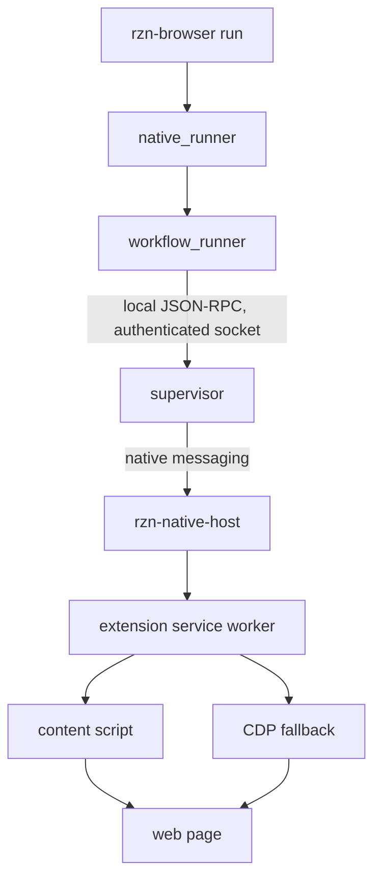
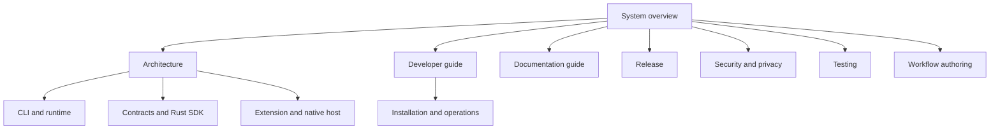

# System overview

RZN Browser runs browser tasks on a local machine. It drives a browser profile
that you own, with your real sessions and logins. A workflow is one JSON file
that describes a repeatable task. An agent or a human runs it with one command.

The product exists to remove per-run LLM cost. A site is figured out once, by a
human or by `llm-auto`, and stored as a workflow. Every replay after that is
deterministic and needs no model.

## Execution path

Each hop has one job:

| Hop | Job |
| --- | --- |
| CLI (`rzn-browser`) | Parses commands, loads workflows, talks to the supervisor. |
| `workflow_runner` | Executes steps, retries, timeouts, and result assembly. |
| Supervisor | Owns local readiness, browser targets, runs, and method dispatch. |
| Native host | Forwards frames between the supervisor and the browser. It chooses no policy. |
| Extension | Performs the page work through content scripts or CDP. |

The supervisor, native host, and extension are the bridge. The browser is the
only component that touches the page.

## Coordination paths

Cloud and fleet are optional coordination layers. They do not replace the local
path.

- **Cloud** pairs an actor and dispatches commands over a WebSocket.
- **Fleet** enrolls a device, polls for jobs over HTTP, fetches workflow data,
  and posts results.

Both paths end in the same local supervisor and extension chain on a machine
that the operator owns.

## Reading order

Read the pages in this order:

1. [Architecture](architecture.md) — component boundaries and the run path.
2. [CLI and runtime](cli-runtime.md) — commands and local runtime state.
3. [Extension and native host](extension-native-host.md) — the browser bridge.
4. [Contracts and Rust SDK](contracts-sdk.md) — data shapes and embedding.
5. [Workflow authoring](workflow-authoring.md) — write or change a workflow.
6. [Installation and operations](installation-operations.md) — install and diagnose.
7. [Testing](testing.md) — pick a check, report proof.
8. [Release](release.md) — package and publish.
9. [Security](security.md) — permissions, side effects, and LLM data.
10. [Developer guide](developer-guide.md) — build and check the repository.
11. [Documentation guide](documentation.md) — write or update these pages.

## Key sources

| Path | Role |
| --- | --- |
| [`crates/rzn_browser/src/main.rs`](../../crates/rzn_browser/src/main.rs) | Command definitions. |
| [`crates/rzn_browser/src/native_runner.rs`](../../crates/rzn_browser/src/native_runner.rs) | CLI adapter into the runtime. |
| [`crates/rzn_browser/src/workflow_runner/`](../../crates/rzn_browser/src/workflow_runner/) | Shared execution loop. |
| [`crates/rzn_browser/src/supervisor.rs`](../../crates/rzn_browser/src/supervisor.rs) | Local method router and runtime state. |
| [`extension/src/background.ts`](../../extension/src/background.ts) | Extension service worker. |
| [`workflows/`](../../workflows/) | Built-in workflow catalog. |

<!-- tusker:docs-map:begin -->

<!-- tusker:docs-map:end -->
