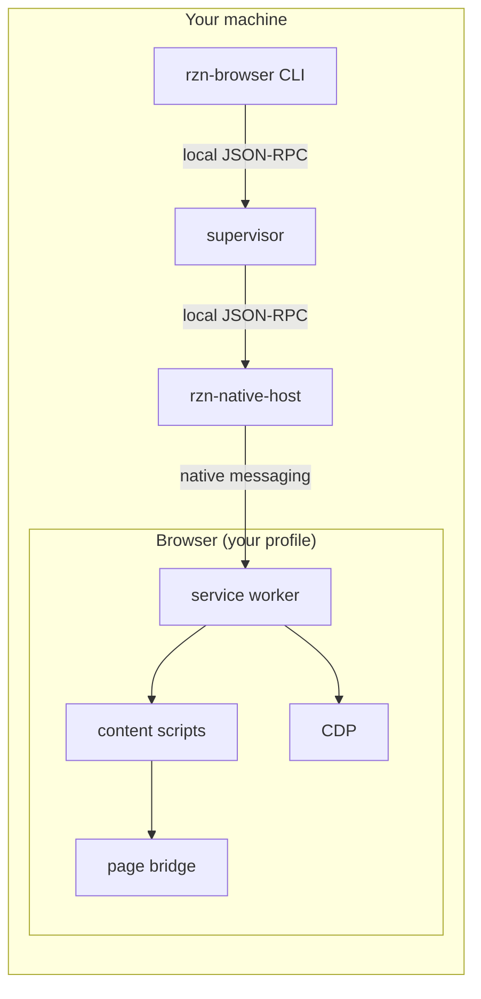
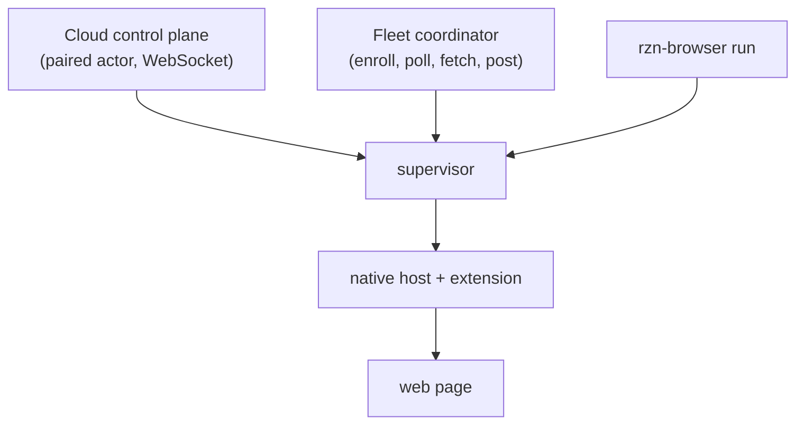

# Architecture

A workflow uses one local execution chain. Each component has one job. The
browser performs the final page action. No component owns another component's
policy.

## Components



| Component | One job |
| --- | --- |
| `rzn-browser` CLI | Parse commands, load workflows, call the supervisor. |
| `workflow_runner` | Execute steps with retry, timeout, and result assembly. |
| Supervisor | Local method router: readiness, targets, runs, settings. |
| `rzn-native-host` | Forward frames between the supervisor and the browser. |
| Service worker | Bridge health, target routing, sessions, CDP actions. |
| Content script | DOM reads and actions inside a frame. |
| Page bridge | Main-world helpers. Visible to page JavaScript. |
| CDP | Explicit fallback for trusted input, frames, accessibility. |

## Execution path

```mermaid
sequenceDiagram
  participant U as User/Agent
  participant C as rzn-browser CLI
  participant S as Supervisor
  participant N as Native host
  participant E as Extension

  U->>C: rzn-browser run system workflow
  C->>C: load + validate workflow JSON
  C->>S: connect, token handshake
  C->>S: runtime.ensure_ready
  S->>N: native_host.extension_call
  N->>E: native messaging frame
  E-->>N: bridge health + capabilities
  N-->>S: ready
  S-->>C: ready
  loop each step
    C->>S: execute step
    S->>N->>E: extension_call(action)
    E-->>N-->>S: step result
    S-->>C: step result
  end
  C->>U: run result
```

The `run` handler is in
[`main.rs`](../../crates/rzn_browser/src/main.rs). The CLI adapter is
[`native_runner.rs`](../../crates/rzn_browser/src/native_runner.rs). The shared
loop is [`workflow_runner`](../../crates/rzn_browser/src/workflow_runner/). The
supervisor owns the local method router and browser bridge in
[`supervisor.rs`](../../crates/rzn_browser/src/supervisor.rs).

## Workflow runner internals

`workflow_runner` is a decoupled execution engine. It does not print to stdout
or manage sockets itself. Two traits keep it host-agnostic:

| Trait | Role |
| --- | --- |
| `StepTransport` | `call(method, params, timeout_ms)` sends one step to the browser session layer. A nonzero `timeout_ms` is a client-side watchdog; `0` awaits directly. |
| `RunEventSink` | Receives progress events: `on_session_open`, `on_step_start`, `on_step_response`, `on_snapshot`, `on_stop`, `on_result`. |

`RunOptions` carries `run_id`, `workflow_hash`, parameters, deadlines,
`SessionSpec`, and `SnapshotMode` into the run.

Each step retries transient errors twice with a 350 ms delay
(`MAX_TRANSIENT_STEP_RETRIES`, `TRANSIENT_STEP_RETRY_DELAY_MS`). Errors that
match an extension-bridge drop or a native-host disconnect retry automatically,
unless the action declares an external-write side effect.

A run ends in a `RunResult` (`rzn.run_result`): `Succeeded`, `Failed`, or
`Stopped`, plus output maps, error details, and failure summaries.

## Workflow catalog

`workflow_roots()` resolves three roots:

1. `workflows/user/` — wins name collisions (`RZN_WORKFLOWS_DIR`).
2. `workflows/builtin/` — the installed catalog (`RZN_BUILTIN_WORKFLOWS_DIR`).
3. The runtime directory (`RZN_RUNTIME_DIR`).

User workflows shadow built-ins. `workflow list` shows the effective entry;
`--all-sources` shows shadowed entries. The catalog code is in
[`workflow_catalog.rs`](../../crates/rzn_browser/src/workflow_catalog.rs).

When a run fails, `workflow_failure_report.rs` builds a
`WorkflowFailureReportContext` — product, system slug, workflow hash, failing
step, error — formats a `FlowFailureReportDraft`, stores it in the run store,
and posts it to `RZN_FLOW_REPORT_URL` or `RZN_REPORT_BASE_URL` when configured.

## Supervisor and persistence

The supervisor binds a Unix socket (or Windows named pipe) under the runtime
root `run/`, holds a token under `secure/`, and takes a process lock
(`rzn-supervisor.lock`). It dispatches JSON-RPC methods for readiness,
sessions, saved runs, settings, and browser inventory.

`run_store.rs` persists every completed run as a line-delimited `RunRecord` in
`index.jsonl` and accepts filtered listing by workflow, status, and origin.
`log_buffer.rs` holds the supervisor's in-memory diagnostics ring.

Fleet mode adds a loop in `supervisor_fleet.rs`: enroll device, poll
coordinator for jobs, fetch workflow data, run locally, post results.

## Code layout

| Path | Role |
| --- | --- |
| [`crates/rzn_browser`](../../crates/rzn_browser/) | CLI, supervisor, workflow catalog, saved runs, cloud, and fleet. |
| [`crates/rzn_native_host`](../../crates/rzn_native_host/) | Browser native-messaging transport to the supervisor. |
| [`crates/rzn_core`](../../crates/rzn_core/) | Framing, runtime paths, secure files, and generated action types. |
| [`crates/rzn_contracts`](../../crates/rzn_contracts/) | Workflow, result, cloud, and fleet data shapes. |
| [`crates/rzn_plan`](../../crates/rzn_plan/) | Planning, LLM providers, and recovery helpers. |
| [`crates/rzn_sdk`](../../crates/rzn_sdk/) | Rust embedding APIs and native-host helpers. |
| [`crates/rzn_plugin_devkit`](../../crates/rzn_plugin_devkit/) | Plugin scaffolding tool. |
| [`extension`](../../extension/) | Service worker, content scripts, page bridge, UI, and browser tests. |
| [`schema`](../../schema/) | `actions.json` action schema and the shared ads manifest shape. |
| [`workflows`](../../workflows/) | Workflow manifest files. |

## Coordination layers

Cloud and fleet are separate control paths that reuse the same local runtime.



- **Cloud** pairs an actor and dispatches commands over its own connection.
- **Fleet** enrolls a device, polls for jobs, fetches workflow data, and posts
  results.

Both paths call the same local browser runtime on a machine that the operator
owns. Neither path runs a remote browser.

## Authority boundaries

- `rzn-browser run` is the normal deterministic run surface.
- `workflow_runner` owns parameter handling, step execution, retry, timeout,
  output selection, and run-result assembly.
- The supervisor owns readiness, bridge inventory, sessions, saved runs,
  settings, and method dispatch.
- The native host forwards frames. It does not choose workflow policy.
- The extension owns page actions and browser-side health.
- Contract crates and `schema/actions.json` define data shapes. Do not copy a
  shape into a second module.

Read [`supervisor.rs`](../../crates/rzn_browser/src/supervisor.rs),
[`manifest.base.json`](../../extension/src/manifest.base.json), and
[`rzn_contracts`](../../crates/rzn_contracts/src/lib.rs) when a boundary is
unclear.
