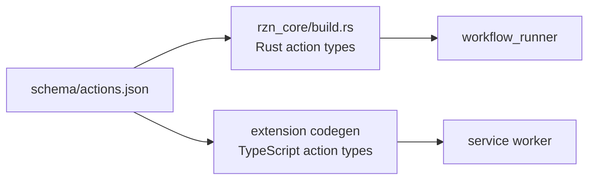
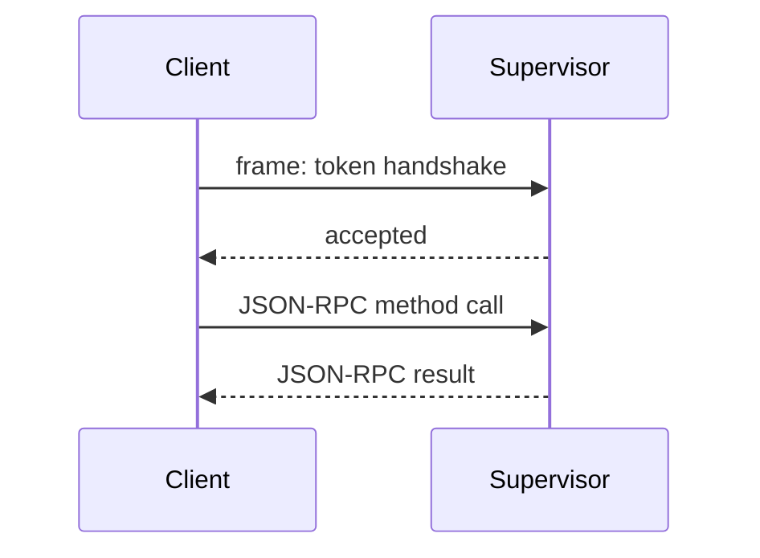

# Contracts and Rust SDK

A data shape has one owner. Use the contract that owns the boundary. Do not
create a second local shape.

## Contract owners

| Purpose | Source |
| --- | --- |
| Browser snapshots, actions, and transcripts | [`rzn_contracts/src/browser.rs`](../../crates/rzn_contracts/src/browser.rs) |
| Workflow manifests, parameters, steps, policy, and run results | [`rzn_contracts/src/workflow.rs`](../../crates/rzn_contracts/src/workflow.rs) |
| Device enrollment, polling, workflow fetch, health, and result post | [`rzn_contracts/src/fleet.rs`](../../crates/rzn_contracts/src/fleet.rs) |
| Local supervisor framing and paths | [`rzn_core/src/framing.rs`](../../crates/rzn_core/src/framing.rs) and [`runtime_paths.rs`](../../crates/rzn_core/src/runtime_paths.rs) |
| Action names and extension code generation | [`schema/actions.json`](../../schema/actions.json) |
| Shared ad manifest shape | [`schema/ads-manifest.json`](../../schema/ads-manifest.json) |

## One schema, two builds

`schema/actions.json` is an input to both builds:

The workflow runner loads the workflow manifest and produces the run-result
contract. The extension action types are generated from the action schema. Rust
action types are also generated from that schema by
[`rzn_core/build.rs`](../../crates/rzn_core/build.rs).

When you change a shape:

1. Identify the boundary.
2. Change the owning contract or schema.
3. Update every producer and consumer.
4. Update adapters in the workflow runner or bridge.
5. Run focused contract tests and `make schema-check`.

## Local protocol

The supervisor socket uses the `rzn.local` protocol. Frames contain a 4-byte
little-endian length and a JSON payload.

A client sends a token handshake. The native host sends `runtime.hello` with
the `native_host_bridge` role instead. See
[`handle_connection`](../../crates/rzn_browser/src/supervisor.rs) and
[`connect_supervisor_runtime`](../../crates/rzn_native_host/src/main.rs).

## Rust SDK

The SDK is an embedding facade. Its host APIs plan and run through the runtime
transport. Its browser tools and session types support in-process callers. They
are separate from the supervisor's in-memory browser session records.

Read [`rzn_sdk/src/lib.rs`](../../crates/rzn_sdk/src/lib.rs),
[`host.rs`](../../crates/rzn_sdk/src/host.rs), and
[`tools.rs`](../../crates/rzn_sdk/src/tools.rs) before adding an integration.
