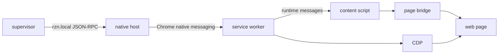
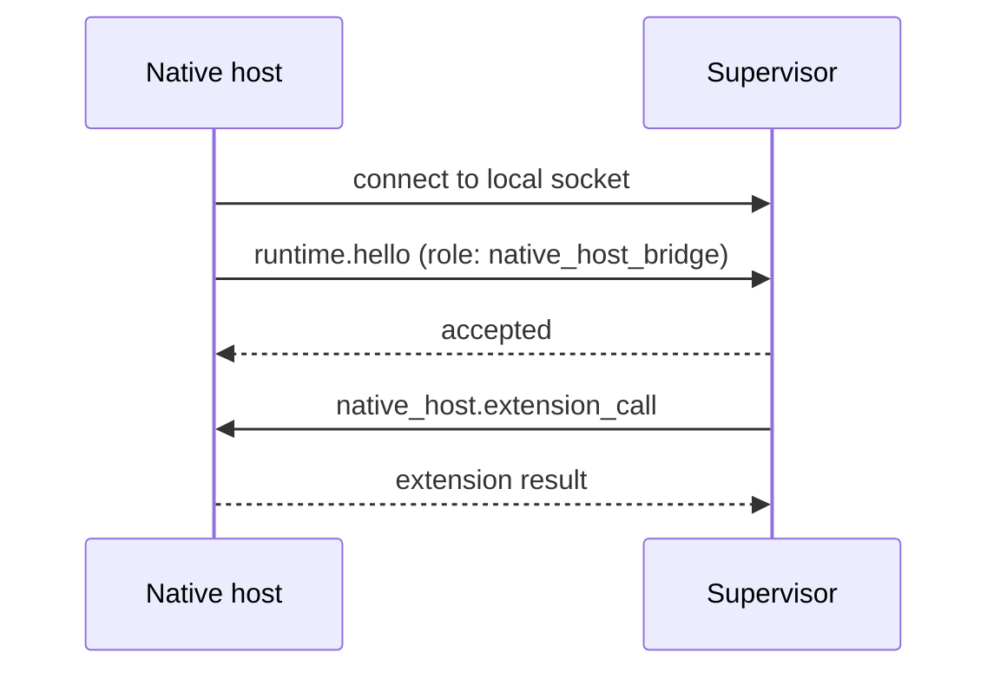

# Extension and native host

The bridge has three parts: the supervisor, the native host, and the browser
extension. The supervisor decides what runs. The native host only moves frames.
The extension performs page work.

## Connection path



The browser starts the native host. The native host forwards frames and does
not own workflow policy. The supervisor owns local readiness and dispatch. The
source is in
[`supervisor.rs`](../../crates/rzn_browser/src/supervisor.rs),
[`rzn_native_host/src/main.rs`](../../crates/rzn_native_host/src/main.rs), and
[`extension/src/background.ts`](../../extension/src/background.ts).

## Handshake



The local protocol is `rzn.local`. A normal client sends a token handshake. The
native host sends `runtime.hello` with the `native_host_bridge` role. JSON-RPC
methods follow the handshake. The bridge accepts
`native_host.extension_call` messages.

## Extension parts

The base manifest loads:

- a Manifest V3 service worker;
- an isolated content script in each frame;
- main-world page and shadow-DOM scripts;
- popup and dashboard pages.

The maintained source targets are Chrome, Edge, and Chromium.

| Part | Owns |
| --- | --- |
| Service worker | Native reconnects, bridge health, target routing, workflow sessions, dashboard calls, CDP actions. |
| Content script | Normal DOM reads and actions in its frame. |
| Page bridge | Main-world helpers. |
| CDP | Explicit fallback for trusted-input, frame, and accessibility cases. |

## Content script and DOM capture

`contentScript.ts` executes the action vocabulary generated from
`schema/actions.json`. DOM capture (`content/dom-capture.ts`) walks the tree
breadth-first, prunes offscreen and non-interactive nodes by `visibleRect`, and
returns semantic element stubs for action resolution and LLM context.

## CDP layer and frame routing

`cdp/cdpClient.ts` is the explicit fallback path. It manages domain activation
(`DOM.enable`, `Runtime.enable`, and so on) with serialized lease accounting
per resolved session, so a failed enable cannot corrupt the next borrower's
state. `cdp/frameRouter.ts` attaches to cross-origin frames: root bookkeeping
uses the tab target, and child frames key on `source.sessionId` to keep
protocol targets and lease keys in sync.

## Popup and dashboard

The extension ships popup and dashboard pages for runs, logs, workflow
inventory, fleet status, and settings. Dashboard calls ride the same service
worker messaging path as workflow execution.

## Frame limits

| Link | Limit |
| --- | ---: |
| Supervisor local frame | 16 MiB |
| Chrome to native host | 64 MiB |
| Native host to Chrome | 1 MiB |

Large responses can use a private local artifact. The shared framing code is in
[`rzn_core/src/framing.rs`](../../crates/rzn_core/src/framing.rs).

## Health

The service worker reconnects after missed heartbeats. The supervisor checks
bridge capabilities and browser target identity. Epoch checks drop replies from
a worker or bridge tied to another runtime root.

Use this order when you diagnose a bridge:

```sh
rzn-browser native-host doctor --browser chrome --json
rzn-browser supervisor status
rzn-browser browser targets
rzn-browser supervisor ensure-ready
```

`doctor` checks files and registration. It does not prove a live page action.

## Security boundary

The extension has broad page, tab, scripting, download, debugger, and native
messaging permissions. Treat it as trusted code for the signed-in browser
profile. The page bridge runs in the page world and is visible to page
JavaScript. Do not use it as a secret boundary.
