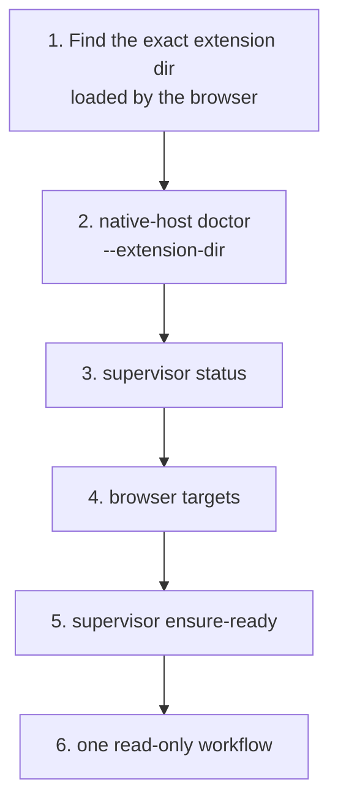

# Installation and operations

## Source and packaged installs

The two installers use different extension layouts.

| Install | Extension path | Native-host registrations |
| --- | --- | --- |
| Source `make install` | `<runtime>/extension/dist/{chrome,edge,chromium}` | Chrome, Edge, Chromium |
| Packaged release | `<runtime>/extension/dist/chrome` | Chrome |

Source setup is in [`setup.sh`](../../setup.sh). Release setup is in
[`scripts/release/install-runtime.sh`](../../scripts/release/install-runtime.sh)
and its PowerShell counterpart.

## Runtime roots

Default roots are selected by
[`runtime_paths.rs`](../../crates/rzn_core/src/runtime_paths.rs):

| System | Default root |
| --- | --- |
| macOS | `~/Library/Application Support/RZN` |
| Linux | `~/.local/share/RZN` |
| Windows packaged install | `%LOCALAPPDATA%\\RZN` |

The root can contain binaries, extension files, workflows, private tokens, and
saved runs. User workflows are separate from built-in workflows.

## Native host

The native host name is `com.rzn.browser.broker`. Use the CLI to write the
registration:

```sh
rzn-browser native-host install --browser chrome
rzn-browser native-host doctor --browser chrome --json
```

Repeat the install for Edge or Chromium after a source install. Do not write a
manifest by hand unless you are debugging the installer.

## Diagnosis

Use this order:



```sh
rzn-browser native-host doctor --browser chrome --json \
  --extension-dir "/exact/path/loaded/by/chrome"
rzn-browser supervisor status
rzn-browser browser targets
rzn-browser supervisor ensure-ready
```

`doctor` can pass when Chrome is closed. It is not live runtime proof.

## Cleanup

Do not delete the whole application root to fix one test. It can contain user
workflows, device tokens, and saved results. Use an explicit disposable
`--app-base` and fleet path for a test, inspect `supervisor status`, then remove
only that owned root.
