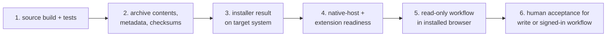

# Release

## Package shape

The artifact builder stages:

- `bin/rzn-browser`;
- `bin/rzn-native-host`;
- `extension/dist/chrome`;
- workflow and example catalogs;
- runtime resources and skills;
- shell and PowerShell installers;
- release metadata and checksum sidecars.

The implementation is
[`build_release_artifacts.py`](../../scripts/release/build_release_artifacts.py).
The packaged installer is
[`install-runtime.sh`](../../scripts/release/install-runtime.sh).

The release installer registers Chrome. Source setup supports Chrome, Edge, and
Chromium. Do not describe the packaged artifact as an Edge or Chromium bundle.

## Checks

Use Make for source checks:

```sh
make build-release
make test
make test-ext-unit
make test-ext-e2e
make schema-check
```

There is no `release-artifacts` Make target. Use the artifact builder from the
release workflow when you need an archive. Run the installer verification
scripts, then run `native-host doctor` against the installed files.

## Publish

The release command prepares the repository and pushes the release tag:

```sh
make release VERSION=1.2.3
```

Check the branch, remote, version files, and permission to push first. If a
check fails, inspect the changed files. Do not reset them without approval.

Plugin build and verify targets have recipes. Plugin publish targets do not.
Do not document them as working publish commands.

## Proof

Report these gates separately:



A green source build is not installed-release or human-acceptance proof.
