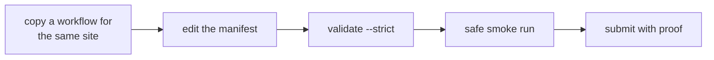

# Workflow authoring

A workflow is one JSON file that describes a repeatable browser task. Start
from a nearby workflow and keep the task specific.



## Start with a nearby file

Put a production workflow in `workflows/<system>/`. Copy a workflow for the
same site and action shape. Keep selectors and site logic in JSON. Keep shared
engine code generic.

## Edit the manifest

Include:

- stable `id`, `name`, `system`, and `capability`;
- typed parameters in `params.properties`;
- ordered actions in `steps`;
- honest top-level and step side effects;
- an output selector and output schema;
- a `help` block with examples and notes.

Parameter kinds:

| Kind | Use | Validation |
| --- | --- | --- |
| `String` | Text input | Optional regex or non-empty rule |
| `Number` | Integer or float | Numeric bounds |
| `Boolean` | Flag | Boolean coercion |
| `Secret` | Credential input | Redacted in logs and telemetry |

Mark secret inputs as sensitive. Do not write secret values to the file or a
log.

### Browse like one person

The CLI queues every manifest run by its `system`. Runs for one site execute one
at a time across processes, and each starts as soon as the previous one ends.
Eight parallel `capterra search` calls run one after another, not at once.
The supervisor drives one run at a time across all sites, so a run that finds
the browser busy with another site waits for it too (`[queue] the browser is
busy ...`) instead of failing.

- Each run reuses the site's parked tab, which stays open between runs and
  comes to the front when the run starts. The exceptions are workflows with `requires_existing_session` (they bind the
  user's active tab) and workflows with `open_new_tab`, `switch_to_tab`, or
  `close_current_tab` steps.
- If a step throws an error that contains `site_challenge`, the site pauses for
  15 minutes. Later runs fail fast and do not reload the challenge page.
- The state lives in `<app base>/site-queue/<system>.json`. Delete that file to
  clear a pause early.

The extension applies two rules to every workflow, so a plain
`navigate_to_url` already browses like a person:

- When the tab already shows the same site, `navigate_to_url` pauses for about
  a second and navigates from inside the page (`location.assign`). The request
  carries the site's referrer, like a click, instead of looking like a fresh
  address-bar visit. The first visit to a site, a different site, or a
  fragment-only change uses a normal browser navigation.
- After `navigate_to_url` and `wait_for_navigation`, the extension checks the
  page for a bot check (Cloudflare, DataDome, PerimeterX, Amazon or Google
  captcha pages, and "verify you are human" walls). A check that clears itself
  within about 8 seconds passes. A wall that stays fails the step with
  `SITE_CHALLENGE` / `site_challenge`, which pauses the site.

The steps set the rest of the pace. Click a link on the current page when the
flow follows one. Do not `fetch` extra pages in the background. Scroll
(`scroll_window_to`) and pause (`wait_for_timeout`) before you extract from a
page a person would read.

Keep timing out of page JavaScript. Chrome throttles timers in background tabs
to about once a minute, so `setTimeout` loops and `simulate_human_behavior`
stall there. Put pauses in `wait_for_timeout` steps, which the runner executes.
Wait for content with a `MutationObserver`. Give `wait_for_navigation` a
`url_pattern`, because without one it waits for the full load event, which slow
ads can delay past the step timeout. The G2 and Capterra packs show the pattern.

## Shipped packs

Production packs live in `workflows/<system>/`: search and research (Google,
Bing, YouTube, PubMed, arXiv, ScienceDirect, Goodreads, Libgen, Yahoo Finance),
commerce and reviews (Amazon, Etsy, G2, Capterra, App Store, Airbnb), ads and
market intelligence (Meta Ad Library, Google Ads Transparency, Apple Ads), AI
apps (ChatGPT, Claude), and social (X, Reddit, Hacker News, Instagram,
LinkedIn). Each pack keeps site logic in JSON and shares the generic engine.

## Validate

```sh
rzn-browser workflow validate workflows/<system>/<name>.json --strict --json
rzn-browser workflow inspect <system> <name>
rzn-browser workflow validate-catalog --strict --json
```

Validate the changed file directly. The catalog check is a second check. It can
choose an effective source and does not replace file review.

Use these commands when source selection is unclear:

```sh
rzn-browser workflow dirs
rzn-browser workflow list --all-sources
rzn-browser workflow inspect <system> <name>
```

## Smoke safely

Run a read-only workflow through the normal path:

```sh
rzn-browser run <system> <name> --param <name>=<value>
```

For a workflow that posts, sends, votes, follows, uploads, or deletes, stop at
the draft or review step unless the operator approved the final action. Read
[Security](security.md) for side-effect and approval rules.

## Submit

Include the workflow JSON, pack documentation when needed, a focused check or
smoke result, the browser and login state used, and the input class. Do not
include page content, credentials, or private account data.
